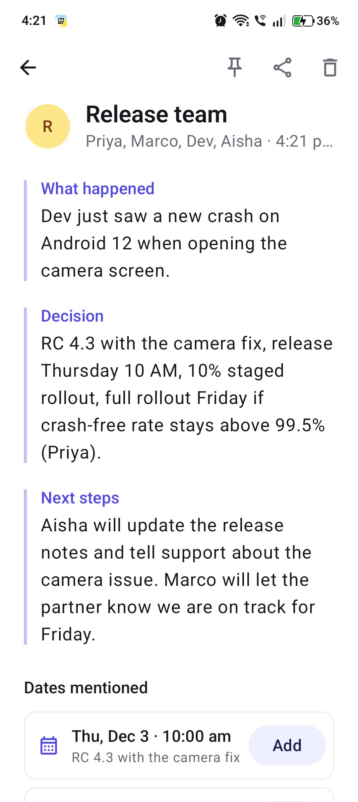

# Nano Digest

**Private, on-device AI summaries for Android. Turn 147 unread messages into 3 bullet points without the internet.**

Nano Digest runs **Gemini Nano** on the phone through the **ML Kit GenAI Summarization API**. There is no server, no API key and no per-request cost, and no text leaves the device. On phones that can't run Gemini Nano, the built-in **Quick summary** engine takes over, so the app works on every Android 8.0+ device.

## Download

**[⬇ Download the latest APK](https://github.com/shiv-eng/gemini-nano-summarizer/releases/latest)** (Android 8.0+)

1. Open the link on your phone and download `NanoDigest-<version>.apk` from **Assets**.
2. Open the file. If Android asks, allow your browser or file manager to **install unknown apps**.
3. Tap **Install**.

Gemini Nano is used automatically on [supported phones](https://developers.google.com/ml-kit/genai#feature-device); every other phone uses the built-in Quick summary.

## Screenshot



<sub>A team chat turned into key points, with dates ready to add to Google Calendar. Taken on a phone without Gemini Nano, so it shows Quick summary.</sub>

---

## Features

### Core
- Gemini Nano summarization via `com.google.mlkit:genai-summarization`
- Feature status check (`UNAVAILABLE / DOWNLOADABLE / DOWNLOADING / AVAILABLE`) before showing any AI action
- Model download with a progress bar (`downloadFeature` + `DownloadCallback`)
- **Streaming output**: words appear as the model generates them
- `CONVERSATION` input type with clean `Name: message` lines
- Chunk-and-combine (map-reduce) for inputs larger than the ~4,000-token window
- Fallback behind our own `SummaryEngine` interface

### Added on top
| Feature | What it does |
|---|---|
| **Inbox-style home** | Every digest is one row (like a chat list): title, time and the key decision. Search, pin to top, share, delete. |
| **Summarize copied text** | One big button: copy a chat anywhere, open the app, tap once. Also available by long-pressing the app icon. |
| **Add to Google Calendar** | Dates and times in a summary ("release Thursday 10 AM", "dinner Saturday 8 PM", "March 14") show up as **Add** buttons that open the calendar app with the event filled in. No calendar permission needed. |
| **Warm-up** | Calls `prepareInferenceEngine()` when the screen opens, so the first summary starts streaming right away. With streaming, this is what makes the app *feel* faster. |
| **Quick summary (offline fallback)** | Works on **every** phone with no model at all. For chats it finds *what happened*, *the decision* and *next steps*, and rewrites messages into plain third-person sentences ("I'll update the notes" → "Aisha will update the notes"). For articles it picks the most central sentences (TextRank + TF-IDF). It takes over automatically when Gemini Nano is unavailable, busy or fails. |
| **Chat export cleaner** | Parses WhatsApp (Android & iOS), Telegram desktop copies and plain chats. It removes timestamps, system notices and deleted messages, turns media into `[shared a photo]`, joins multi-line messages and replaces URLs with `[link]` to save tokens. |
| **"Catch up on" window** | Summarize only the last 50 / 100 / 200 messages (the unread ones). |
| **Auto input detection** | Detects whether the text is a chat or an article and picks the right `InputType`. |
| **On-device language detection** | ML Kit Language ID picks English/Japanese/Korean automatically. It routes unsupported languages to the offline engine instead of returning a bad summary. |
| **Share & select-to-summarize** | Share text, a `.txt` file or a **WhatsApp "Export chat" zip** to the app, or select text in any app → **Summarize** (`ACTION_PROCESS_TEXT`). |
| **File import** | Open a `.txt` or a WhatsApp export `.zip` from storage. |
| **Stored on the phone** | Digests live in a Room database that is excluded from cloud backup. |
| **Read aloud** | On-device text-to-speech for any summary. |
| **Live metrics** | Time to first words, total time, chunk count, characters and estimated tokens. |
| **Speed test** | Times Gemini Nano and Quick summary on the same text (Settings → Advanced). |
| **Friendly errors** | AICore/GenAI error codes (601, 606, BUSY, …) are turned into plain-language messages. |
| **Summary methods** | Automatic, Gemini Nano only, or Quick summary only. |
| **Design** | Material 3, clean white by default (Light / Dark / Follow phone in Settings), the standard type scale that respects the system font size, and edge-to-edge layout. |

---

## Architecture

```
app/src/main/java/com/nanodigest
├── core
│   ├── engine
│   │   ├── SummaryEngine.kt        # our interface over every backend
│   │   ├── GeminiNanoEngine.kt     # ML Kit GenAI: status, download, warm-up, streaming inference
│   │   ├── ExtractiveEngine.kt     # Quick summary: offline fallback
│   │   ├── ChatDigest.kt           # what happened / decision / next steps for chats
│   │   ├── SummaryPipeline.kt      # engine choice, fallback, chunk-and-combine, streaming events
│   │   ├── ModelManager.kt         # app-scoped download / warm-up state
│   │   ├── GenAiErrors.kt          # error code → explanation + fix
│   │   └── SummaryModels.kt
│   ├── text
│   │   ├── ChatFormatter.kt        # WhatsApp / Telegram / plain chat → "Name: message"
│   │   ├── DateFinder.kt           # "Thursday 10 AM" → calendar event suggestions
│   │   ├── TextChunker.kt          # paragraph → line → sentence → word splitting
│   │   └── TextStats.kt
│   └── lang/LanguageDetector.kt    # ML Kit Language ID (bundled, offline)
├── data                            # Room history, settings, share/import plumbing
└── ui                              # Compose: Summarize, History, Engine & settings
```

The UI depends only on `SummaryEngine` and `SummaryPipeline`. ML Kit GenAI is still in beta, so all of it is isolated in `GeminiNanoEngine`.

### How a summary is produced

1. **Prepare**: detect chat vs article, clean the chat export, apply the "last N" window, detect the language.
2. **Choose an engine**: Gemini Nano if it is supported and the language fits, otherwise the extractive engine (AUTO mode).
3. **Chunk** if the text is over 10,000 characters (~2,500 tokens).
4. **Map**: summarize each chunk into 3 bullets ("Reading part 2 of 4").
5. **Reduce**: summarize the joined notes as an `ARTICLE` into your bullet count, collapsing them in rounds if they still don't fit.
6. **Stream** the final pass to the screen, then save it to history.

---

## Requirements

- **Gemini Nano**: a [supported device](https://developers.google.com/ml-kit/genai#feature-device) (recent Pixels and some flagships) with a locked bootloader, an up-to-date *Android AICore*, and Wi-Fi for the one-time model download. **No Android emulator can run Gemini Nano** (emulator images don't include AICore), so on the emulator the app uses Quick summary.
- **Everything else**: Android 8.0 (API 26)+.

## Build

- JDK 17, Android SDK 35
- AGP 8.8, Kotlin 2.1, Gradle 8.10.2 (wrapper included)

```bash
./gradlew :app:assembleDebug        # build
./gradlew :app:testDebugUnitTest    # 37 unit tests: chunker, chat parser, chat digest, date finder, Quick summary, pipeline
./gradlew :app:installDebug         # install on a connected phone
```

## Try it

1. Copy a group chat (or an article) in any app.
2. Open Nano Digest and tap **Summarize copied text**. Or long-press the app icon → **Summarize copied text**.
3. On the digest, tap **Add** next to a date to put it in Google Calendar.
4. Other ways in: share a WhatsApp **Export chat** to Nano Digest, select text in any app → **Summarize**, or tap the pencil to paste or type.
5. No chat handy? On a fresh install, tap **See an example**.

## Privacy

Text is processed on the device only, by Gemini Nano inside the AICore system app or by the built-in extractive engine. History lives in a local database that is excluded from backups. The ML Kit libraries declare the `INTERNET` permission (used by AICore setup and ML Kit itself). The app's own code makes no network calls.

## Limits to know

- Gemini Nano summarization supports **English, Japanese and Korean** input.
- Each call accepts about 4,000 tokens. Longer inputs use chunk-and-combine, which costs one call per chunk plus a reduce call, and fine details can be lost.
- AICore can rate-limit (`BUSY`) and rejects background use, so summaries run only while the app is in the foreground.
- Output is AI-generated and labelled as such. Check important details.

## License

MIT
